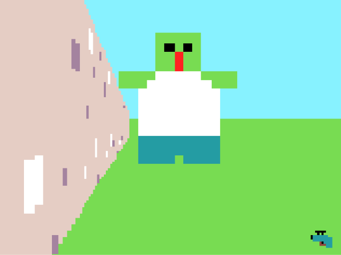
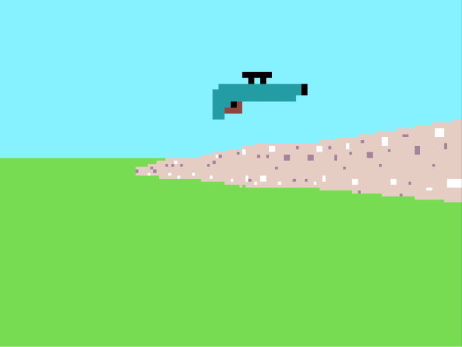
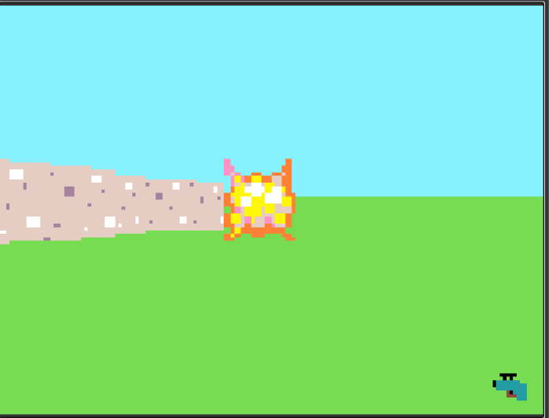
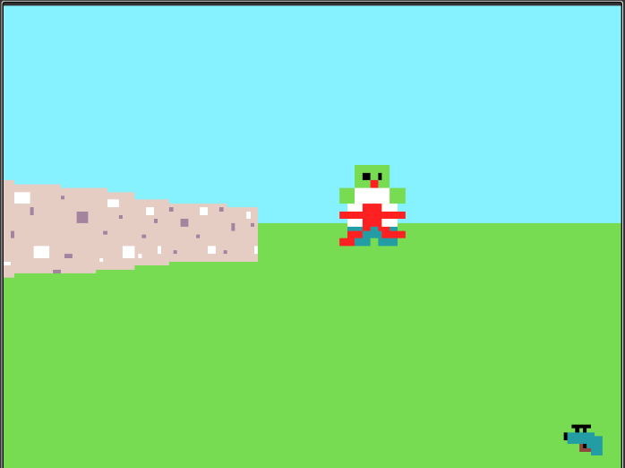

# 🧊 3D (First-Person 3D World)

Direct Link: [https://arcade.makecode.com/S26834-62110-54783-26444](https://arcade.makecode.com/S26834-62110-54783-26444)

> 🚀 **Click the button above to explore my 3D world directly in your web browser!**

**My 3rd game** built with **Microsoft MakeCode Arcade**! 🕹️✨  
Created by a 2nd-grade elementary school developer (ME!!!), this project takes coding to the next dimension by creating a **3D first-person environment** (using raycasting) with custom wall textures, sky and grass rendering, and 3D spatial navigation!

## 🖼️ Gameplay Screenshot

---

## 🎨 3D Environment & Custom Textures

Every wall texture and world color was designed in the MakeCode Arcade Editor to create a bright, immersive 3D space:

| Asset | Name | Role & Description |
| :---: | :---: | :--- |
| **Textured Stone Wall** | **3D Wall Tile:** Custom beige/tan wall texture decorated with white and purple pixel patterns that scale dynamically with distance. |
| **Bright Sky** | **Ceiling / Background:** A clear, bright sky-blue horizon rendered above the 3D walls. |
| **Green Grass Ground** | **Floor / Terrain:** A vibrant green grassy ground rendered below the walls to give a strong sense of depth and perspective. |

---

## 🧠 Key Programming Features & 3D Logic

* **3D Raycasting Engine:** Transformed a 2D tilemap into a **3D first-person perspective**, calculating wall heights and angles in real time as the player moves and turns.
* **Depth & Perspective Rendering:** Walls appear larger when the player walks closer (as seen on the left) and smaller in the distance (on the right), creating a realistic 3D illusion on a 2D arcade screen.
* **3D Navigation & Collision Detection:** Programmed smooth forward/backward walking and camera rotation while preventing the player from walking through solid 3D walls.

---

## 🕹️ Controls (Keyboard)

| Key | Action |
| :--- | :--- |
| **⬆️ / ⬇️ (Up / Down Arrows)** | Walk forward and backward through the 3D world |
| **⬅️ / ➡️ (Left / Right Arrows)** | Turn the camera left and right to look around |

---

## 💻 Development Environment
* **Engine:** [Microsoft MakeCode Arcade](https://makecode.com) (`arcade-raycasting` 3D extension)
* **Core Concepts Used:** 3D Raycasting Perspective, Custom Wall Textures, Spatial Movement & Camera Rotation, Tilemap Wall Collisions
* **Developer:** 2nd Grade Elementary School Student (ME!!!) 👦👧

